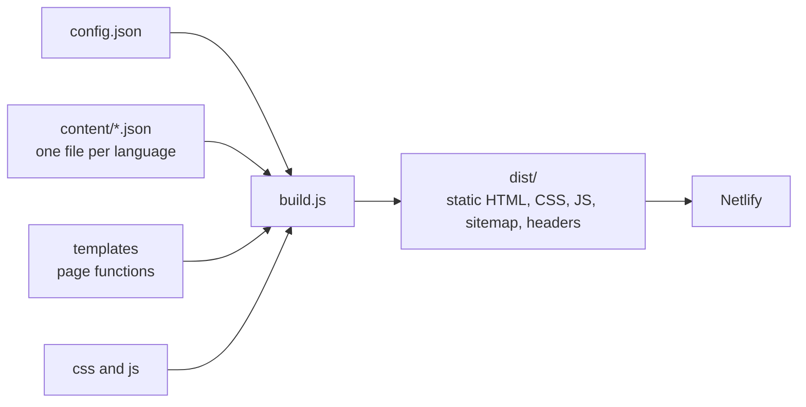

# KN Consult: multilingual website (showcase)

A website for **KN Consult**, a Sofia-based accounting, audit and legal practice that helps foreign companies set up and run a business in Bulgaria. I built it as a replacement for the firm's outdated WordPress site.

**Live site:** https://kn-consult.netlify.app

> This repository is a showcase: screenshots, architecture notes and a few representative code samples. The full source is kept private because it contains the client's content and configuration. I'm happy to walk through the real code on request.

## What it is

- Five languages: Bulgarian (default), English, Italian, German and Romanian
- Eight pages per language: home, accounting, audit, legal, consulting, why Bulgaria, contacts and privacy
- Contact form with validation and a consent checkbox
- No framework and no runtime dependencies: a small Node.js script generates plain HTML, CSS and JavaScript

## Goals

1. **Look credible to foreign clients.** A calm blue and silver palette, clear typography and a photo-led hero.
2. **Load fast.** The Bulgarian home page transfers roughly 300 KB, with no third-party requests.
3. **Respect privacy.** Self-hosted fonts, no tracking, no external scripts, an honest cookie notice.
4. **Be easy to maintain.** Text lives in one JSON file per language, so the owner can change it without touching code.

## Architecture

- **Content is data, layout is code.** Templates are plain JavaScript functions that return HTML strings. Each language file has the same shape.
- **English fallback.** If a translation key is missing, the build uses the English text and prints a warning, so a half-finished translation never breaks a page.
- **Generated extras.** Sitemap with language alternates, `robots.txt`, redirects from the old WordPress addresses, security headers and a favicon are all produced at build time.

## Decisions worth mentioning

| Decision | Why |
|----------|-----|
| Static generation instead of a CMS or framework | The content changes rarely, so there is nothing to host, patch or secure at runtime. |
| Design tokens in one CSS file | The whole palette changed twice during the project, and each change was a one-file edit. |
| Self-hosted fonts with `unicode-range` subsets | GDPR-friendly, and visitors only download the alphabets they need (Latin, Cyrillic or Latin-extended for Romanian). |
| Strict Content Security Policy generated at build time | The build hashes the few inline scripts and writes the policy, so it can't drift out of date. |
| `prefers-reduced-motion` respected | Animations are light and add polish, but are switched off for people who ask for that. |
| Contrast checked for text and buttons | Button and text colours meet WCAG AA contrast. |

## Samples

- [`samples/tokens.css`](samples/tokens.css): the design tokens (colour, type, spacing)
- [`samples/content-fallback.js`](samples/content-fallback.js): merging a translation over the English base with warnings
- [`samples/security-headers.js`](samples/security-headers.js): generating the CSP with script hashes

## Stack

Node.js · HTML · CSS · vanilla JavaScript · Netlify

## Status

Live as a client preview. Pending: the client's final content, logo and domain.

## License

Proprietary. All rights reserved.
